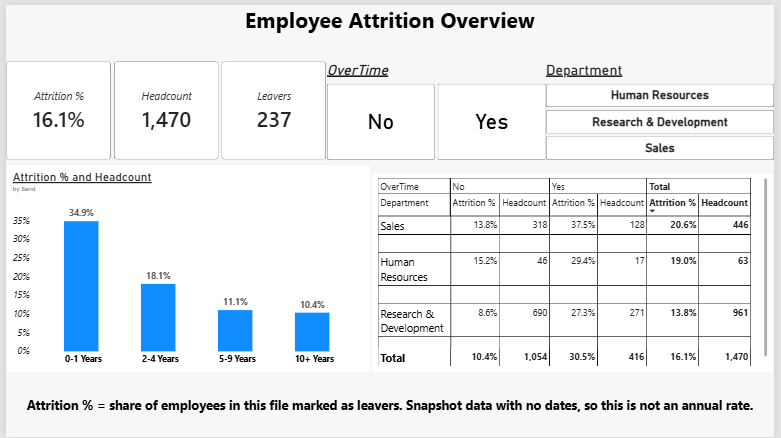

# Employee Attrition Analysis (SQL, Python, Power BI)

An end-to-end analysis of employee attrition in a fictional HR dataset: data checks and aggregation in SQL, cleaning and charting in Python, and an interactive Power BI dashboard.



## The question

Which groups of employees have the highest attrition, and what goes with it?

## Data

- **IBM HR Analytics Employee Attrition & Performance** dataset (Kaggle). It is **fictional, practice data**: 1,470 employees, 35 columns. It contains no real personal information.
- It is a **snapshot with no dates**, so "attrition %" here means *leavers ÷ headcount in the file*, not an annual rate.
- The CSV is not included in this repository. Download it from Kaggle (licensed under ODbL v1.0; see "Data license and attribution" below) and place it in `data/`.

## Tools and what each did

| Tool | Used for |
|---|---|
| SQL Server | Checked the data (1,470 rows, no duplicate employee IDs), then grouped attrition by department, overtime and tenure |
| Python (pandas, matplotlib) | Cleaned the data, created tenure bands, rebuilt the SQL results to cross-check them, and exported a cleaned CSV |
| Power BI | Built the dashboard: DAX measures (headcount, leavers, attrition %), slicers, tenure chart, department by overtime matrix |

The main results (overall rate, tenure bands, and department by overtime) matched exactly across the tools.

## Key findings

- **Overall:** 237 of 1,470 employees are marked as leavers (**16.1%**).
- **By department:** Sales is highest at **20.6%** (446 employees), followed by HR at 19.0% (63) and R&D at 13.8% (961).
- **By tenure:** attrition is highest in the first year (**34.9%** at 0-1 years) and lowest at 10+ years (**10.4%**).
- **By overtime:** employees who work overtime leave at **30.5%** vs **10.4%** for those who don't (416 vs 1,054 employees). The gap holds in **every tenure band** and every department. For example, in the 5-9 years band it is 24.1% vs 6.1%, about 4 times as high.

## Limitations

- The data shows an **association, not a cause**. Job role, level and pay are in the file but not yet tested, and employee feedback is not in the file at all.
- It is a snapshot with no dates, so it cannot show *when* people left. A leaver's tenure stops on the day they left, while a stayer's keeps growing, so tenure comparisons are not like for like.
- Small groups are fragile: HR employees who work overtime number only 17 (about 5 leavers).
- A survey reaches current employees only. It cannot explain why the 237 leavers left; exit interviews would be needed for that.

## Next step

A draft employee workload and wellbeing survey (anonymous, with group-level reporting) to investigate *why* overtime and attrition go together. The results would be compared with this dashboard by department and tenure band. See `survey/workload_survey.md`.

## Repository structure 

```

├── README.md
├── data/                     (note only; see Data section)
├── sql/attrition_analysis.sql
├── python/attrition_analysis.ipynb
├── powerbi/hr_attrition_dashboard.pbix
├── images/dashboard.png
├── images/tenure_attrition.png
└── survey/workload_survey.md

```

## How to reproduce

1. Download the dataset and import it into SQL Server as a table named `employees`.
2. Run the queries in `sql/`.
3. Run the notebook in `python/`. It exports a cleaned CSV.
4. Open the `.pbix` file and point the data source at the cleaned CSV.

## Data license and attribution

The data comes from the IBM HR Analytics Employee Attrition & Performance
dataset on Kaggle, which is licensed under the Open Data Commons Open
Database License (ODbL) v1.0: https://opendatacommons.org/licenses/odbl/1.0/

The `.pbix` file contains a modified copy of this data (added columns such as
the tenure band), so it is shared under the same ODbL v1.0 license. The SQL,
Python code and written analysis are my own work.

## About

Karthikeyan · [LinkedIn](https://www.linkedin.com/in/karthikeyanb7) · officialbkarthikeyan@gmail.com
